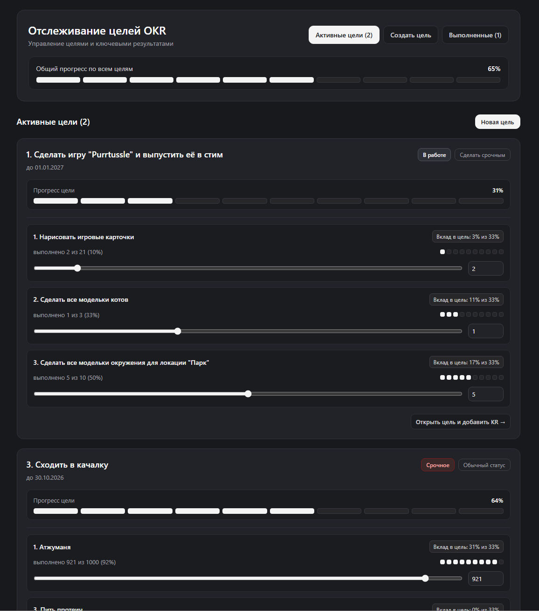
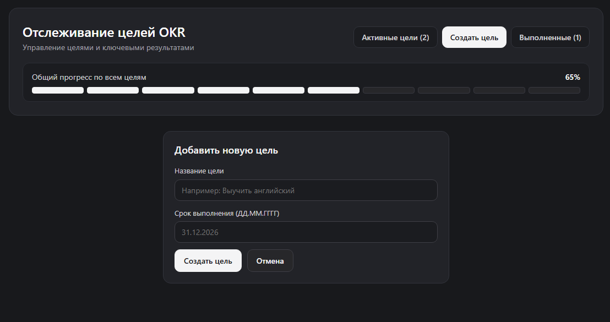
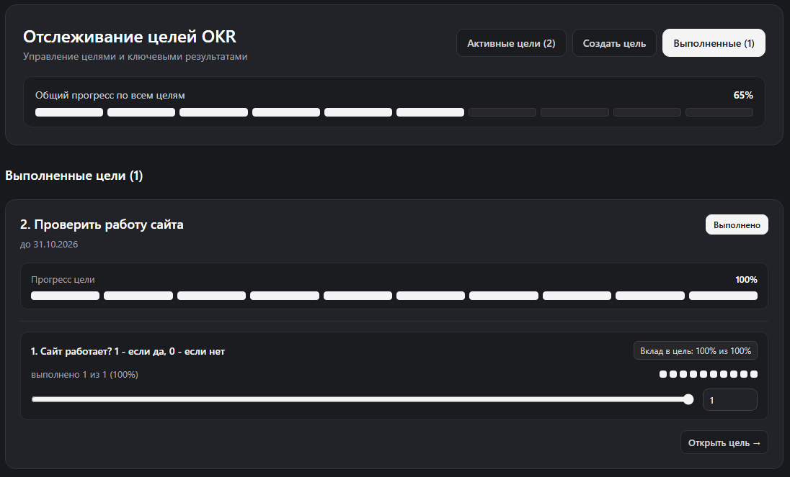
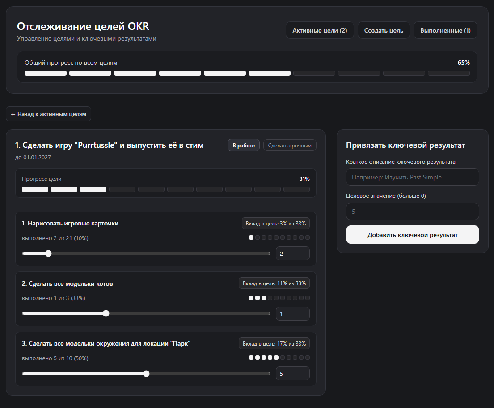

# Отслеживание целей OKR (Курсовой проект — Лабораторная работа №5)

Веб-приложение и библиотека переиспользуемых UI-компонентов для управления целями OKR и ключевыми результатами (Key Results).

Подробная проектная документация:
- [Архитектурные требования (`architecture.md`)](./architecture.md)
- [Функциональные требования и границы MVP (`mvp.md`)](./mvp.md)

## Состав проекта

Репозиторий содержит два TypeScript-проекта (`type: "module"`):

1. **`ui-library`** (`@my-app/ui-library`) — библиотека общих UI-компонентов (`OkrGoalCard`, `KeyResultList`, `Button`, `Card`) и утилит расчёта прогресса и валидации (`okrUtils.ts`). Покрытие тестами Jest — **100%**.
2. **`frontend`** — основное веб-приложение на React + TypeScript + Vite с маршрутизацией (`react-router-dom`) и сохранением состояния в `localStorage`.

### Маршруты приложения
- `/` — активные цели (`GoalsPage`)
- `/create` — создание новой цели (`CreateGoalPage`)
- `/goals/:id` — детальная страница цели и добавление ключевых результатов (`GoalDetailsPage`)
- `/completed` — выполненные цели (`CompletedGoalsPage`)
- `*` — страница 404 (`NotFoundPage`)

## Инструкция по установке и запуску

### Шаг 1. Сборка библиотеки компонентов (`ui-library`)

```bash
cd ui-library
npm install
npm run build
```

Команды проверки в `ui-library`:
- `npm run dev` — сборка в режиме отслеживания (`watch`)
- `npm run build` — компиляция TypeScript и сборка пакета в `dist/`
- `npm run lint` / `npm run lint:fix` — проверка стиля кода через ESLint
- `npm run test` / `npm run test:coverage` — запуск юнит-тестов Jest с отчётом покрытия

### Шаг 2. Запуск основного приложения (`frontend`)

```bash
cd ../frontend
npm install
npm run dev
```

После запуска приложение будет доступно по адресу `http://localhost:5173`.

Команды проверки в `frontend`:
- `npm run dev` — запуск dev-сервера Vite
- `npm run build` — проверка типов и сборка production-бандла
- `npm run lint` / `npm run lint:fix` — проверка кода через ESLint
- `npm run test` / `npm run test:coverage` — запуск тестов Jest

## Примеры работы приложения

- Страница активных целей (`/`):

- Страница создания цели (`/create`):

- Страница выполненных целей (`/completed`):

- Детальная страница цели с ключевыми результатами (`/goals/:id`):

